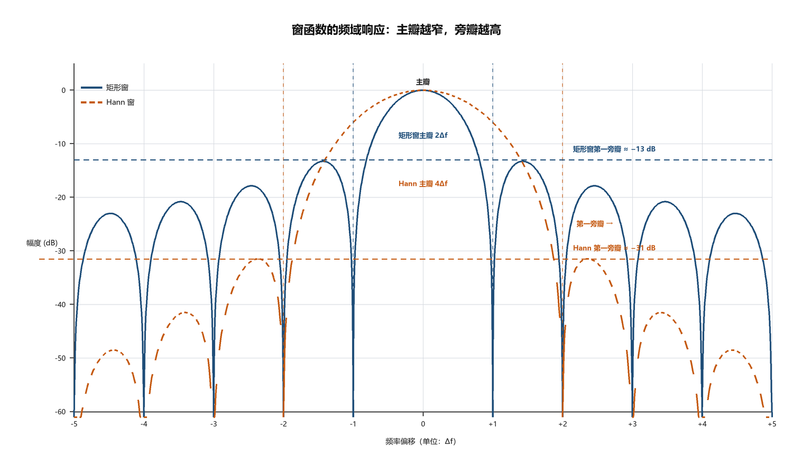

# C2000-DSP-Spectrum

DSP 学习计划 W3：从采样数据到"能读"的频谱——DFT/FFT、栅栏效应、窗函数与 dB 标定。

## 文件说明

| 文件 | 说明 |
|---|---|
| `my_spectrum.m` | 可复用的单边幅度谱函数（频率轴 / 归一化 / 单边 / ×2 四道工序） |
| `spectrum_demo.m` | 复合信号（1 kHz + 2.5 kHz + 50 Hz + 白噪声）的频谱、加窗与 dB 对比 |
| `w3_day1_4_fft_comprehensive_demo.m` | Day 1–4 实验合集：谐波叠加、栅栏效应、分辨率对比 |
| `window-mainlobe-sidelobe.png` | 窗函数主瓣 / 旁瓣标注图 |

## 关键结论

### 1. 一张能读的频谱需要四道工序

1. 频率轴：`f = (0:N-1)*(fs/N)`
2. 归一化：除以**实际**采样点数 `N`
3. 单边谱：只取 `1 : floor(N/2)+1`
4. 幅度修正：除 DC 与 Nyquist 外 ×2

### 2. 栅栏效应

| 信号位置 | 峰值 |
|---|---|
| 落在 bin 正中心 | 1.000 |
| 落在两个 bin 中间 | 0.637（低 3.9 dB） |

幅度偏低不等于信号变弱，可能只是没有落在格点上。

### 3. 窗函数的取舍

| 项目 | 矩形窗 | Hann 窗 |
|---|---|---|
| 主瓣宽度 | 2 bins | 4 bins |
| 第一旁瓣 | −13 dB | −31 dB |
| 扇贝损失 | 3.9 dB | 1.4 dB |
| 相干增益 | 1.0 | 0.5 |

## 实测结果

| 信号 | 设定幅度 | 实测幅度 |
|---|---|---|
| 50 Hz | 0.30 | 0.2984 |
| 1000 Hz | 1.00 | 0.9951 |
| 2500 Hz | 0.50 | 0.4999 |
| 噪声底（σ=0.1） | — | ≈ −50 dB |

## 运行

MATLAB R2020a 及以上。把 `my_spectrum.m` 放在同一目录，直接运行 `spectrum_demo.m`。
